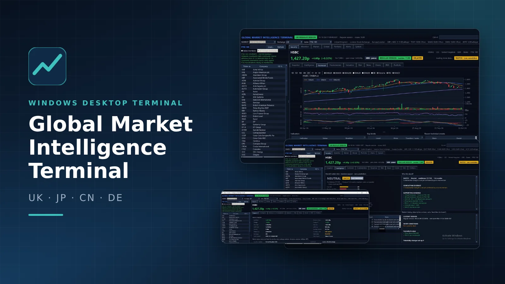

# Global Market Intelligence Terminal (V3.2) — case study

**A Windows desktop research workspace for four equity markets. Public overview only — implementation details are private.**

> Not investment advice. Decision support only. Data may be delayed, incomplete or wrong.

## What it is

A desktop terminal that brings UK, Japan, China (Shanghai and Shenzhen) and German equities into one workspace: prices, technical studies, fundamentals, valuation, risk, news, events and a multi-currency portfolio. Every figure carries its source, unit and status; missing values are reported rather than filled.

## Public capability summary

- Four markets, each with its own calendar, session hours and currency (GBP/GBX, JPY, CNY, EUR)
- Ten-tab workspace per security, from snapshot through to position
- Evidence-first assessments: supporting and contradicting evidence, confidence and risks — `WATCH` when inputs disagree instead of a forced verdict
- Multi-currency portfolio with exchange-rate timestamp, watchlists and price alerts
- Market and sector context, relative strength and benchmark comparison
- Packaged as a standalone Windows executable with an installer

## Screens

*Illustrative demo screen. Prices are delayed and shown for interface demonstration only; not recommendations.*

## Verification status (engineering checks only)

- 760 automated tests in the full suite; 752 passed on Linux (Python 3.12), 8 environment-dependent skips
- Windows run and EXE build verified
- RSI reproduces the Wilder / StockCharts reference series
- UK, Japan and Germany holiday calendars spot-checked for 2026–2027
- Live Yahoo Finance data and exchange listings verified at build time

## Known limitations

- Default market data is delayed and comes from an unofficial provider; market-data licences are not included
- Assessments are transparent heuristics with adjustable weights — no predictive validation and no win-rate claim
- The terminal does not connect to a broker and never sends orders
- Windows desktop only

## Status and availability

This is a commercial product I built and own. Source code, architecture, scoring details and the full test suite are **private** and are released only after an NDA and a signed agreement.

For evaluation, a live demo or licensing: https://t.me/faithoper — please do not send confidential material in a first message.

See also: [GitHub profile](https://github.com/alirezasedmir1991) · [GCIT case study](https://github.com/alirezasedmir1991/gcit-crypto-intelligence-terminal)
